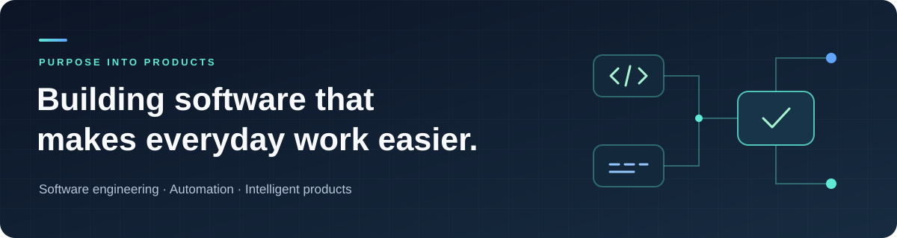
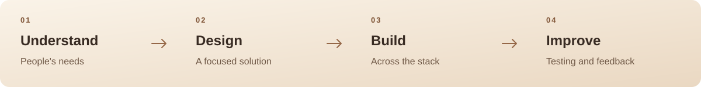

<h1>Sajjad Ur Rehman</h1>

Computer Science at NUST · Class of 2027 · Islamabad, Pakistan

Full stack development &nbsp; · &nbsp; Automation &nbsp; · &nbsp; Applied AI

<a href="https://github.com/sajjadgill720?tab=repositories">Explore my work</a> &nbsp; · &nbsp;
<a href="#selected-projects">Selected projects</a> &nbsp; · &nbsp;
<a href="#lets-connect">Let's connect</a>

## About me

I'm a computer science student and product builder who enjoys turning everyday friction into useful software. My work spans web applications, automation, data pipelines, and intelligent systems, with a focus on helping people save time and make better decisions.

I like working across the whole product: understanding a user's needs, designing the interface, building the backend, and refining the experience through testing and feedback. My long-term ambition is to build a technology company around dependable products that people find useful.

## Selected projects

### ⚡ [Demo Automation Platform](https://github.com/sajjadgill720/demo-automation-platform)

Preparing a tailored product demo takes research, clarification, and repetitive setup. I'm building a platform that brings knowledge uploads, voice interactions, and demo previews into one workflow for sales and product teams.

My work includes backend orchestration, multi-file knowledge handling, frontend integration, and latency improvements through shared database connections and reusable workflow components.

TypeScript · TanStack Start · Python · FastAPI · PostgreSQL · Supabase · LangGraph

### 🌍 [AQI Predictor](https://github.com/sajjadgill720/AQI-PREDICTOR)

An air quality forecasting project for Pakistani cities, connecting data collection, feature engineering, scheduled model training, and an interactive dashboard. It brings the data pipeline and prediction experience together so forecasts are easier to explore.

Data pipelines · Forecasting · Model evaluation · Visualization

### 🧪 [Automated Machine Learning Platform](https://github.com/sajjadgill720/Automated-Machine-Learning-AutoML-Platform)

A modular system for tabular machine learning that handles preprocessing, model training, evaluation, selection, and hyperparameter tuning. Built to make experiments more organized and repeatable.

Python · scikit-learn · Feature engineering · Hyperparameter tuning

### 🏋️ [GymRetain](https://github.com/sajjadgill720/GymRetain)

An application in development to help gym owners understand attendance and member engagement. I'm working on QR check-ins, visit frequency, capacity, and trainer assignments to make daily operations easier to manage.

TypeScript · Operational dashboards · Member retention

More projects and experiments

| Project | What it explores |
| :--- | :--- |
| [PSX Halal Screener](https://github.com/sajjadgill720/PSX-Halal-Screener) | An open source tool for examining Shariah compliance of stocks on the Pakistan Stock Exchange. |
| [Academic Policy Q&A](https://github.com/sajjadgill720/Scaleable-Academic-Policy-QA) | Retrieval over the NUST handbook using TF-IDF, SimHash, and MinHash. |
| [AI Boom & Dot-Com Research](https://github.com/sajjadgill720/AI-concentration-trap-vs-dotcom-research) | Comparing technology market cycles through valuation metrics, P/E analysis, and data visualization. |
| Code Sync | A collaborative editor project combining shared coding rooms, chat, and an AI assistant with React, Node.js, Express, and MongoDB. |

## Current focus

<table>
<tr>
<td width="50%" valign="top">
<h3>🌱 Knovera</h3>

My final-year project explores personalized learning for children aged 4–14, with learning activities, progress signals, and parent insights.

Productive struggle · Age-appropriate support · Consent and privacy

</td>
<td width="50%" valign="top">
<h3>🔎 Research & engineering</h3>

Deepening my understanding of LLM evaluation, reasoning-oriented retrieval, and responsive, maintainable backend systems.

Experimentation · Retrieval · Reliability · User feedback

</td>
</tr>
</table>

## Technologies

| Area | Tools I work with |
| :--- | :--- |
| Languages | Python · TypeScript · JavaScript · SQL · Java |
| Frontend | React · TanStack Start · HTML · CSS |
| Backend | FastAPI · Node.js · Express |
| Data & infrastructure | PostgreSQL · Supabase · MongoDB · Docker · Git |
| AI & analytics | Pandas · NumPy · scikit-learn · LangGraph · Vector search |

## How I build

I start with the people facing a problem and define what a useful outcome looks like. Then I break the work into clear decisions, connect the interface with the backend and data, and use measurements and feedback to improve the result.

## Let's connect

I'm interested in software engineering opportunities, product development, research, and collaborations around tools that help people work, learn, or make decisions.

If that overlaps with what you're building, I'd be glad to connect through [my GitHub profile](https://github.com/sajjadgill720).

Understand the problem. Build with purpose. Keep improving.

